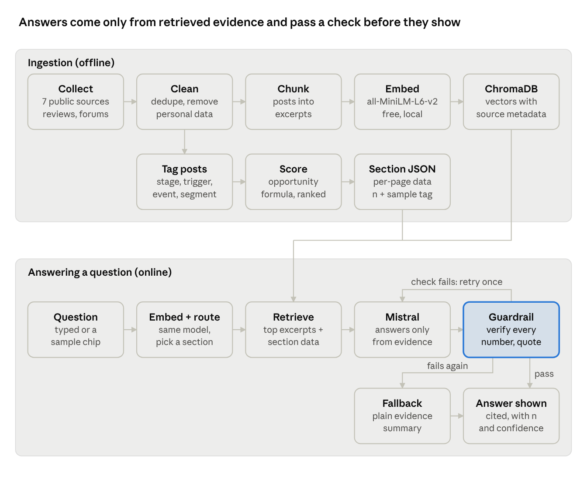

# PRD: SIP Discovery Engine (RAG Chatbot Prototype)

Nov 1, 2026 · Ishwari Deshmukh

## Overview and problem

The SIP Discovery Engine is a prototype RAG chatbot that tells the Groww team which SIP problem to fix first, and backs every answer with cited public evidence. It is a hobby prototype built to test RAG end to end.

**Business metric:** the share of first-time investors with an active SIP 12 months after their first one. Active means at least one successful instalment in the last 30 days.

**Problem:** first-time investors pause, reduce or quietly stop SIPs in year one, and the evidence for why is scattered across thousands of public reviews and posts. A summary or sentiment score says how users feel. It does not say which problem moves 12-month continuation, how often it occurs, or whom it hits.

**Solution:** ingest public sources, tag each post (stage, trigger, event, segment, failure mode), rank opportunity areas with a documented score, and let users ask questions. Answers come only from retrieved evidence, with a citation, a sample size and a confidence level.

## Goals, non-goals and success metrics

The prototype succeeds when it answers the nine discovery questions with grounded, cited answers and ranks opportunities against 12-month continuation.

**Goals**

1. Answer the discovery questions from the problem statement, such as why people start a SIP and what leads them to pause or stop.
2. Identify, quantify and rank SIP opportunity areas, each linked to 12-month continuation, not to sentiment.
3. Prove a working RAG pipeline on free, lightweight tools: MiniLM embeddings, ChromaDB, Mistral and Streamlit.
4. Stay compliant: no investment advice, no personal data, no performance claims.

**Non-goals**

- Investment advice, fund or stock picks, return calculations or comparisons.
- User accounts, personalisation or real-time data.
- Production scale, uptime targets or multiple languages.
- Private Groww data, app back-end screenshots or third-party blogs as sources.

**Success metrics**

| Metric | Target | Current |
| --- | --- | --- |
| Retrieval top-3 hit rate on the 20-item golden set | 80% or more | 100% (16 of 16) on the tuned golden set; 71% (5 of 7) on held-out questions never used for tuning |
| Engine vs human agreement on core tagging fields | Not set | Not measured yet; a 40-post labelling sheet is ready |
| Answers with one citation link | 100% | |
| Answers of 4 sentences or fewer | 100% | |
| Numbers and quotes in answers found in the evidence | 100%, else fall back to an evidence summary | |
| Advice or fund-pick questions declined with an official link | 100% | |

## Target users

The primary user is a Groww product manager choosing which SIP problem to solve first. First-time SIP investors are the people studied, not users of the tool.

| User | What they need | How they use the product |
| --- | --- | --- |
| Groww PM (primary) | A ranked, defensible answer to "what do we fix first?" | Asks questions in the research tool; reads the Overview |
| Project assessor | Proof the findings are quantified, validated and honest about limits | Checks citations, the Validation and Method sections |
| Designer or researcher | Real user language and where in the journey problems appear | Reads quotes, journey stages and segment patterns |
| Public reader | Understand what was studied and found in two minutes | Browses the site sections without chatting |

## User stories

Eight stories cover the prototype: four about getting answers, two about trust, and two about safe behaviour.

| # | As a | I want to | So that |
| --- | --- | --- | --- |
| 1 | PM | ask "Which opportunity should we solve first, and why?" | I get a ranked answer with its sample size and confidence |
| 2 | PM | ask "What leads investors to pause, reduce or stop a SIP?" | I see the failure modes and triggers, not only "markets fell" |
| 3 | PM | ask how first-time investors differ from experienced ones | I know what is specific to the metric's target group |
| 4 | Any user | start from 4 sample question chips | I know what the tool can answer without guessing |
| 5 | Assessor | open the citation on every answer | I can check each number and quote against its source |
| 6 | Assessor | see how the engine was validated and where it failed | I can judge how far to trust its findings |
| 7 | Any user | ask "Which SIP is safest?" and get a polite refusal with an AMFI or SEBI link | the tool never gives investment advice |
| 8 | Any user | get "Insufficient evidence" when data is thin | I am not misled by a confident answer built on a few posts |

## Functional requirements

The chatbot must ingest and tag public posts, retrieve the right evidence for a question, and answer only from that evidence with a citation.

| ID | Area | Requirement | Priority |
| --- | --- | --- | --- |
| FR-1 | Ingestion | Collect public sources from the problem statement: Play Store and App Store reviews, Reddit, TradingQ&A, X, YouTube comments, Team-BHP, and SIP information pages (full URL list in the appendix) | P0 Must |
| FR-2 | Ingestion | Remove duplicates and strip personal data (usernames, PAN, Aadhaar, phone, email, account numbers) before storage | P0 Must |
| FR-3 | Ingestion | Chunk text into excerpts and embed them with sentence-transformers/all-MiniLM-L6-v2 | P0 Must |
| FR-4 | Ingestion | Store chunks in ChromaDB with source, URL, date and tags as metadata | P0 Must |
| FR-5 | Analysis | Tag each post with: about SIPs, stage, trigger, event, segment, theme, failure mode; version the tagging prompt | P0 Must |
| FR-6 | Analysis | Score opportunities: 100 × (0.40 reach + 0.30 severity + 0.15 stage fit + 0.15 segment fit); drop any part stated by fewer than 5 posts and rescale the weights | P0 Must |
| FR-7 | Analysis | Export one JSON file per section plus sections_index.json; each value carries n, a sample tag and a computed status | P1 Should |
| FR-8 | Retrieval | Embed the question with the same model, route it to a section or "out of scope", and fetch that section's JSON plus the top excerpts | P0 Must |
| FR-9 | Answer | Prompt Mistral to answer only from the retrieved evidence, in 4 sentences or fewer | P0 Must |
| FR-10 | Answer | Show with every answer: one citation link, sample size, confidence (High, Medium or Low with a reason), 2 to 3 de-identified quotes with source and month, and "Last updated from sources" | P0 Must |
| FR-11 | Guardrail | Check every number and quote in the answer against the evidence; retry once, then fall back to a plain evidence summary | P0 Must |
| FR-12 | Guardrail | Badge each answer: Evidence-grounded, Low sample, Insufficient evidence (fewer than 15 supporting items) or Out of scope | P0 Must |
| FR-13 | Guardrail | Decline advice, fund picks, "safest SIP", returns, projections and questions about individuals; link to the official factsheet, AMFI or SEBI investor pages | P0 Must |
| FR-14 | Answer | Offer 2 follow-up chips after each answer: "Show quotes" and "Break down by segment" | P1 Should |

## UX and UI requirements

Streamlit is the stack for both the prototype and the public site. The prototype has four sections; the public site expands them into six read-only Streamlit pages plus an "Ask the engine" research panel in the sidebar of every page.

| Prototype section | Website pages | What it answers |
| --- | --- | --- |
| Overview | Overview | Which opportunity to solve first, and what unmet needs emerge |
| Patterns | Journey, Drop-offs, Segments | Why people start, what they check, what leads them to stop, how segments differ |
| Evidence | Validation, Method | How quality was checked, where the engine failed, how the pipeline works |
| Research tool | Ask the engine (Streamlit sidebar on every page) | Any discovery question, answered from the evidence |

**Research tool**

- Empty state shows a short intro, the disclaimer and exactly 4 sample question chips. No answer appears until the user clicks a chip or sends a question.
- Sample chips: "What leads investors to pause, reduce or stop a SIP?" · "Where do investors go when they are unsure?" · "Which opportunity should we solve first, and why?" · "How do first-time investors differ from experienced ones?"
- Each answer links to its page section, for example "See: Drop-offs → Failure modes", which opens the page and scrolls there.

**Pages**

- Every page title is a sentence stating its key message. The header has a section tag, the title, and one italic line saying what the page answers.
- Same layout on every page: 3 to 4 stat tiles, charts and tables in cards, a Key insights panel, then a Source and limits line.
- Every number loads from generated JSON. A missing value shows a "Not yet computed" card with the reason and the missing step.
- Value tags: Scored, Low sample, Not computed, Context only.

**Visual style and accessibility**

- Light theme, teal accent #0b6e69, warm off-white background #f5f3ee, white cards with a thin border; colours set in Streamlit's theme config (.streamlit/config.toml).
- Okabe-Ito colour-blind-safe palette; never colour alone (add labels, patterns, markers).
- Body text 16px or more; charts readable on mobile; tables scroll sideways inside their own container.
- Disclaimer in the footer and in the research tool.

## Data sources and RAG architecture

Two pipelines share one embedding model: an offline pipeline builds the evidence store, and an online pipeline answers each question from it.

The guardrail sits between the LLM and the user. An answer with an unverified number or quote is retried once, then replaced by a plain evidence summary.

**Stack**

| Component | Choice | Note |
| --- | --- | --- |
| Embeddings | sentence-transformers/all-MiniLM-L6-v2 | Free and lightweight; same model for documents and questions |
| Vector store | ChromaDB | Stores excerpts with source, URL, date and tags |
| LLM | Mistral API | Tagging and answers use ministral-14b-latest (tagging prompt v1); key kept server-side |
| Backend | FastAPI, /api/ask on port 8000 | Reuses the existing retrieval and guardrail code |
| UI | Streamlit multipage app, port 8502 (8501 is taken by another local app) | Used for both the prototype and the public site (decided 2026-11-01) |

**Sources** (current corpus, fetched 2026-11-01; posts dated 2016-05-26 to 2026-10-31)

| Source | Items fetched | Records (after de-duplication) | Excerpts | SIP posts | SIP posts with a failure mode |
| --- | --- | --- | --- | --- | --- |
| Google Play (11 apps) | 18,805 | 14,485 | 14,491 | 945 | 459 |
| Forums (TradingQ&A, Jupiter, madefortrade) | 3,289 | 3,242 | 4,339 | 1,103 | 391 |
| Reddit | 774 | 720 | 794 | 253 | 41 |
| App Store (5 apps) | 45 | 45 | 55 | 15 | 8 |
| Team-BHP | 1 page | 15 | 17 | 8 | 0 |
| SIP information pages | 8 | 8 | 102 | context only | context only |
| YouTube | 0 | 0 | 0 | – | – |
| **Total** | **22,922** | **18,515** | **19,798** | **2,324** | **899** |

Items fetched are raw reviews, posts and pages before duplicates and empty posts are removed. Excerpts are records split to fit the embedding model. SIP posts and failure modes come from FR-5 tagging (`ministral-14b-latest`), so they are model labels, not hand counts. Google Play includes Groww's larger pull (5,000 newest plus 5,000 most relevant reviews), giving 7,331 Groww records from 2018 to 2026; Forums includes 2,149 posts from topics found by the TradingQ&A search. The App Store review feed was empty at fetch time, so only the newest reviews on each app page were loaded. SIP information pages are context only and are never tagged or counted as evidence. YouTube is skipped until `YOUTUBE_API_KEY` is set in `Code/.env`, and X is dropped because its API needs a paid plan. A 21-person SIP investor survey supplements the public posts in the original plan; its data is not loaded into this prototype yet. Every ingestion URL is listed in the appendix.

## Non-functional requirements

Grounding and compliance outrank speed and polish: a wrong number or a piece of advice is a worse failure than a slow answer.

| Area | Requirement |
| --- | --- |
| Grounding | Never invent a number or quote; the guardrail verifies both before an answer is shown |
| Compliance | No investment advice, fund recommendations or performance claims; no fear, FOMO or urgency language; disclaimer always visible |
| Privacy | Public sources only; never accept or store PAN, Aadhaar, account numbers, OTPs, emails or phone numbers; quotes de-identified, 25 words or fewer, labelled with source and month only |
| Transparency | Counts are mentions in public posts and a small survey, not population percentages; figures under 10 posts tagged "Low sample"; every answer shows "Last updated from sources" |
| Security | Mistral API key and Reddit API client ID and secret kept server-side only |
| Cost | Free, lightweight components: MiniLM runs locally, ChromaDB stores locally, Streamlit hosts the UI |
| Accessibility | Colour-blind-safe charts, 16px minimum text, mobile-friendly tables (see UX and UI) |

## Risks, open questions and milestones

The biggest risk is thin evidence exactly where the metric lives: 178 of 2,324 SIP posts sit in months 2 to 12, and 97 come from first-time investors, 36 of whom state a problem.

**Risks**

| Risk | Impact | Mitigation |
| --- | --- | --- |
| Thin evidence for first-time investors and months 2 to 12 | Confident-sounding answers on a handful of posts | Low sample and Insufficient evidence badges; say what data would help |
| Public posts lean towards complaints | Problems look bigger than they are | Present counts as relative mentions; cross-check with the survey |
| LLM invents a number or quote | Wrong decision on false evidence | Guardrail check, one retry, then a plain evidence summary |
| Tagging errors (agreement with a human labeller not measured yet) | Mis-ranked opportunities | Publish per-field agreement; re-check weak fields against the golden set |
| Small, skewed survey (21 SIP investors, mostly 26 to 30, salaried) | Survey cannot confirm first-time patterns | State the limit on every page that uses it |
| Thin or uneven sources (X dropped, YouTube empty without a key, App Store limited to the newest reviews) | Claims lean on Google Play and forums | Show per-source counts; snapshot raw data so results are reproducible |

**Assumptions**

- Public posts show the relative importance of problems, even if not their true population share.
- Mistral's API tier is enough for prototype traffic.

**Open questions**

- What answer latency is acceptable?
- How often are sources refreshed, which sets the "Last updated from sources" date?
- Does the 15-item "Insufficient evidence" threshold apply per answer or per section?
- Who adds the real "Corrections" items from the AI Evidence Log?

**Milestones**

1. RAG pipeline: ingest, clean, chunk, embed, store in ChromaDB (running).
2. Chat backend on FastAPI with retrieval and guardrail (running).
3. Streamlit prototype with the four sections (running).
4. JSON export script for all page data.
5. Website layout, nav, footer and tag components.
6. Pages in order: Method, Overview, Journey, Drop-offs, Segments, Validation.
7. "Ask the engine" panel wired to the backend.
8. Public deploy, then run the acceptance checklist from the UI spec.

## Appendix: data ingestion URLs

These public URLs feed the ingestion pipeline for SIP reviews and posts. Google Play reviews are the main source, with thousands of reviews per app.

**Link check, 2026-11-01:** all 43 URLs were fetched by script, as the ingestion pipeline would fetch them. 36 work as given, 2 needed a new URL (ET Money's Play Store ID and Kotak Securities' SIP page), and 5 block scripted access (2 Reddit, Team-BHP, X, kotakmf.com). Every forum thread and all five App Store apps now also have a working JSON endpoint. Alternatives for the blocked sources are at the end of this appendix.

### Google Play reviews

| App | App ID | Status | Note |
| --- | --- | --- | --- |
| [Groww](https://play.google.com/store/apps/details?id=com.nextbillion.groww) | com.nextbillion.groww | Working | |
| [Paytm Money](https://play.google.com/store/apps/details?id=com.paytmmoney) | com.paytmmoney | Working | |
| [Zerodha Coin](https://play.google.com/store/apps/details?id=com.zerodha.coin) | com.zerodha.coin | Working | |
| [ET Money](https://play.google.com/store/apps/details?id=com.smartspends) | com.smartspends | Updated | Old ID com.smartspends.leapfrog returns 404 |
| [INDmoney](https://play.google.com/store/apps/details?id=in.indwealth) | in.indwealth | Working | |
| [Upstox](https://play.google.com/store/apps/details?id=in.upstox.app) | in.upstox.app | Working | |
| [Zerodha Kite](https://play.google.com/store/apps/details?id=com.zerodha.kite3) | com.zerodha.kite3 | Working | |
| [Angel One](https://play.google.com/store/apps/details?id=com.msf.angelmobile) | com.msf.angelmobile | Working | |
| [Kotak MF](https://play.google.com/store/apps/details?id=com.godbtech.kotakmf) | com.godbtech.kotakmf | Working | |
| [Sundaram MF](https://play.google.com/store/apps/details?id=com.sundarammutal.invappv2) | com.sundarammutal.invappv2 | Working | |
| [ICICI Pru MF](https://play.google.com/store/apps/details?id=com.iPruAMC) | com.iPruAMC | Working | |

Reviews cover failed instalments, autopay mandates, step-up, redemption delays and NAV dates. All 11 listings load under the IDs above.

### App Store reviews (latest ~500 per app)

| App | App ID | JSON review feed | Status | Note |
| --- | --- | --- | --- | --- |
| [Groww](https://apps.apple.com/in/app/groww-stocks-mutual-fund-ipo/id1404871703) | 1404871703 | [RSS feed](https://itunes.apple.com/in/rss/customerreviews/page=1/id=1404871703/sortby=mostrecent/json) | Working | 50 reviews per feed page |
| [Zerodha Kite](https://apps.apple.com/in/app/id1449453802?see-all=reviews) | 1449453802 | [RSS feed](https://itunes.apple.com/in/rss/customerreviews/page=1/id=1449453802/sortby=mostrecent/json) | Working | 50 reviews per feed page |
| [Kotak MF](https://apps.apple.com/in/app/id878896606?see-all=reviews) | 878896606 | [RSS feed](https://itunes.apple.com/in/rss/customerreviews/page=1/id=878896606/sortby=mostrecent/json) | Working | 50 reviews per feed page |
| [ICICI Pru MF](https://apps.apple.com/in/app/id862996339?see-all=reviews) | 862996339 | [RSS feed](https://itunes.apple.com/in/rss/customerreviews/page=1/id=862996339/sortby=mostrecent/json) | Working | 50 reviews per feed page |
| [Sundaram MF](https://apps.apple.com/in/app/id6742233114?see-all=reviews) | 6742233114 | [RSS feed](https://itunes.apple.com/in/rss/customerreviews/page=1/id=6742233114/sortby=mostrecent/json) | Working | Feed holds only 5 reviews |

### Forums, social and video

| Platform | Thread or page | JSON endpoint | Status | Note |
| --- | --- | --- | --- | --- |
| TradingQ&A | [Coin auto-SIP workflow is broken](https://tradingqna.com/t/coins-customer-workflow-is-broken-for-auto-sip/173335) | [JSON](https://tradingqna.com/t/coins-customer-workflow-is-broken-for-auto-sip/173335.json) | Working | 1 post |
| TradingQ&A | [Coin SIP mandate failures after pooling ended](https://tradingqna.com/t/discontinuation-of-pooling-for-mutual-funds-and-how-it-affects-coin/120947) | [JSON](https://tradingqna.com/t/discontinuation-of-pooling-for-mutual-funds-and-how-it-affects-coin/120947.json) | Working | 1,038 posts; page through the JSON |
| TradingQ&A | [Coin SIP vs AMC SIP](https://tradingqna.com/t/coin-sip-vs-amc-sip/127618) | [JSON](https://tradingqna.com/t/coin-sip-vs-amc-sip/127618.json) | Working | 20 posts |
| TradingQ&A | [Is Coin SIP really SIP?](https://tradingqna.com/t/coin-sip-is-it-really-sip/39724) | [JSON](https://tradingqna.com/t/coin-sip-is-it-really-sip/39724.json) | Working | 4 posts |
| TradingQ&A | [Coin user complaints](https://tradingqna.com/t/zerodha-coin-is-minimalism-turning-into-neglect/193950) | [JSON](https://tradingqna.com/t/zerodha-coin-is-minimalism-turning-into-neglect/193950.json) | Working | 3 posts |
| TradingQ&A | [Best MF platform: Groww, INDmoney, Kuvera](https://tradingqna.com/t/which-is-the-easiest-and-best-mutual-fund-investment-platform/128149) | [JSON](https://tradingqna.com/t/which-is-the-easiest-and-best-mutual-fund-investment-platform/128149.json) | Working | 21 posts |
| TradingQ&A | [Search: groww sip](https://tradingqna.com/search?q=groww%20sip) | [JSON](https://tradingqna.com/search.json?q=groww%20sip) | Working | 36 matching posts |
| Jupiter community | [Groww, Paytm Money and ET Money users compare](https://community.jupiter.money/t/mutual-funds-which-app-why/2177) | [JSON](https://community.jupiter.money/t/mutual-funds-which-app-why/2177.json) | Working | 13 posts |
| madefortrade | [Mutual fund autopay experiences](https://madefortrade.in/t/auto-payment-limit-set-in-mutual-funds/22208) | [JSON](https://madefortrade.in/t/auto-payment-limit-set-in-mutual-funds/22208.json) | Working | 5 posts |
| Reddit | [Groww SIP autopay mandate](https://www.reddit.com/r/IndiaInvestments/comments/qmdq75/) | [Arctic Shift post](https://arctic-shift.photon-reddit.com/api/posts/ids?ids=qmdq75), [comments](https://arctic-shift.photon-reddit.com/api/comments/tree?link_id=qmdq75) | Updated | Reddit's own JSON returns 403; use the Reddit API or Arctic Shift |
| Reddit | [r/IndiaInvestments search: groww sip](https://www.reddit.com/r/IndiaInvestments/search/?q=groww%20sip&restrict_sr=1) | [Arctic Shift search](https://arctic-shift.photon-reddit.com/api/posts/search?subreddit=IndiaInvestments&query=groww%20sip&limit=100) | Updated | 61 posts in the archive; fetch comments per post |
| Team-BHP | [Mutual funds thread, page 344](https://www.team-bhp.com/forum/shifting-gears/105873-mutual-funds-thread-344.html) | [Wayback copy](https://web.archive.org/web/20250322093106id_/https://www.team-bhp.com/forum/shifting-gears/105873-mutual-funds-thread-344.html) | Blocked for scripts | Live site returns 403; Wayback copy hit a 429 rate limit during the test |
| X | [Live search: groww sip](https://x.com/search?q=groww%20sip&f=live) | | Login required | Dropped from ingestion; the API needs a paid plan |
| YouTube | [Search: groww sip review](https://www.youtube.com/results?search_query=groww+sip+review) (comments) | | Working | Page loads; pull comments with the YouTube Data API |

### SIP information pages

| Provider | Page | Status | Note |
| --- | --- | --- | --- |
| Kotak | [Mutual funds: basic SIP queries answered](https://www.kotak.bank.in/en/stories-in-focus/mutual-funds/get-your-basic-queries-answered.html) | Working | |
| Kotak | [Kotak Bank: What is SIP](https://www.kotak.bank.in/en/stories-in-focus/mutual-funds/what-is-sip.html) | Working | Added as a kotakmf.com alternative |
| Kotak | [Kotak MF: SIP](https://kotakmf.com/sip) | Blocked for scripts | Radware bot captcha; use the Kotak pages around it or the [Wayback copy](https://web.archive.org/web/20260804180530id_/https://www.kotakmf.com/sip) |
| Kotak | [Kotak MF: What is SIP blog, June 2026 (PDF)](https://dms.kotakmf.com/DMS/public/upload/1781087651732_What_is_SIP_Blog_-_10th_June_2026.pdf) | Blocked for scripts | Link opens an app page, not the file; download in a browser |
| Kotak | [Kotak MF: New SIP page content, May 2025 (PDF)](https://dms.kotakmf.com/DMS/public/upload/1747832702800_New_SIP_Page_Website_Content_-_17th_May_2025.pdf) | Blocked for scripts | Link opens an app page, not the file; download in a browser |
| Kotak | [Kotak Neo: What is SIP](https://www.kotakneo.com/investing-guide/mutual-funds/sip/) | Updated | Old kotaksecurities.com link times out; its www version redirects here |
| Zerodha Coin | [SIP on Coin](https://support.zerodha.com/category/mutual-funds/features-on-coin/systematic-investment-plan/articles/sip-on-coin) | Working | One of 7 support articles on SIP setup, mandates, step-up SIP and payments |
| Upstox | [What is SIP](https://upstox.com/learning-center/mutual-funds/what-is-sip-meaning-benefits-factors-how-it-works/article-932/) | Updated | Old link redirects here; more pages on step-up SIP, the calculator and stock SIP help |
| Angel One | [Types of SIPs](https://www.angelone.in/knowledge-center/mutual-funds/types-of-sips) | Working | More pages on how to invest, top-up SIP, top-up vs regular SIP |
| Groww | [SIP calculator](https://groww.in/calculators/sip-calculator) | Working | |

Information pages give context for factual answers only; the chatbot never uses them to calculate or compare returns.

### Alternatives for blocked sources

Each blocked source has a replacement, tested on 2026-11-01. Reddit and kotakmf.com have working fallbacks today; Team-BHP's archive copy exists but was rate-limited during the test.

| Blocked source | Alternative | Test result |
| --- | --- | --- |
| Reddit | Official API: create a free "script" app at [reddit.com/prefs/apps](https://www.reddit.com/prefs/apps) for a client ID and secret, then call oauth.reddit.com. No-signup fallback: the [Arctic Shift](https://arctic-shift.photon-reddit.com/api/posts/search?subreddit=IndiaInvestments&query=groww%20sip&limit=100) research archive | Arctic Shift post search returns 61 Groww SIP posts, and per-post comment trees load. Its comment text search timed out 3 times, so fetch comments post by post. The API needs credentials, so it was not tested |
| X | Dropped. The API needs a paid plan, and posts are mostly short complaints at support accounts; Google Play has the same kind of review for free | Not tested |
| Team-BHP | Wayback Machine copy: find the latest with the [availability API](https://archive.org/wayback/available?url=https://www.team-bhp.com/forum/shifting-gears/105873-mutual-funds-thread-344.html), then download `web.archive.org/web/<timestamp>id_/<thread URL>` for the raw page | A copy from 2025-03-22 exists, but the raw download returned 429 (rate limit) 3 times; space requests out |
| kotakmf.com | Same SIP content from Kotak pages without a captcha (rows added to the SIP information table); last resort, a [Wayback copy](https://web.archive.org/web/20260804180530id_/https://www.kotakmf.com/sip) | Wayback copy downloads (303 KB). Both Kotak PDF links open an app page, not the file, so download them in a browser |
